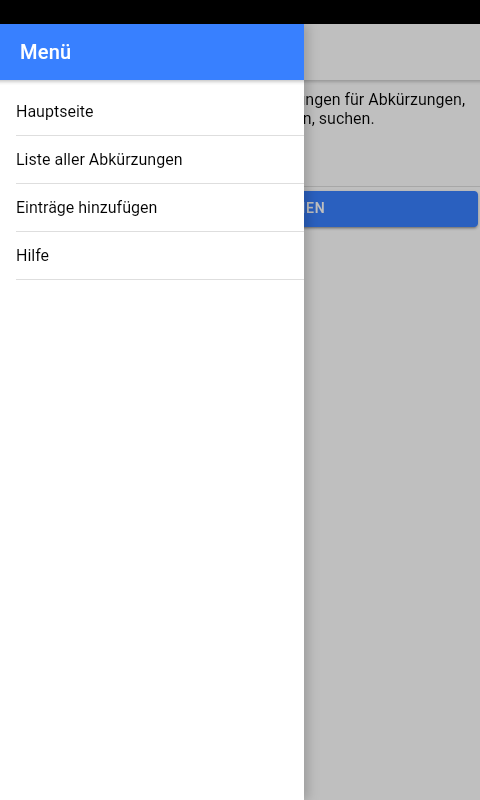
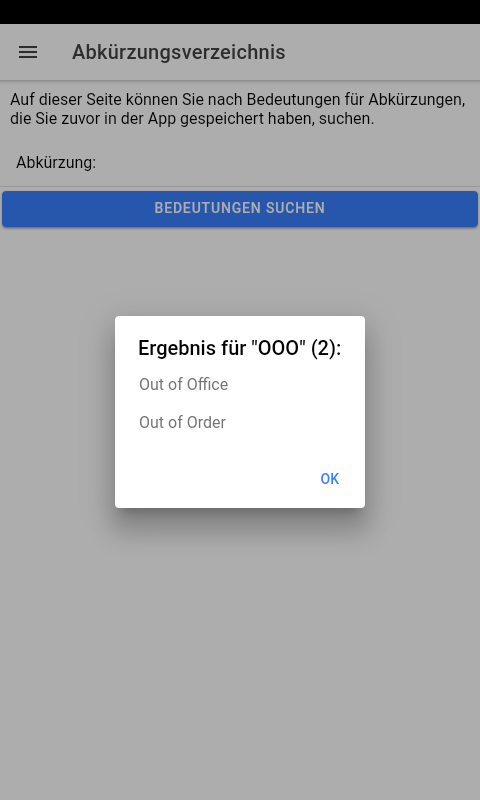
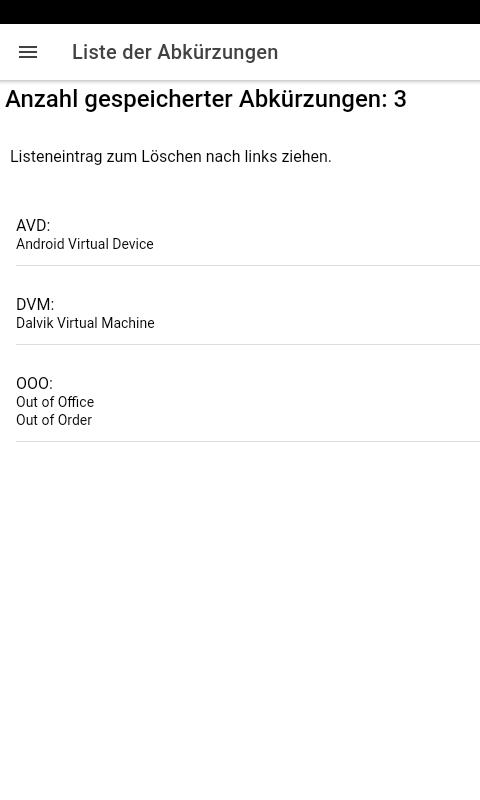

# Ionic-App "AbkVerz" (Abkürzungs-Verzeichnis) #

 

Diese Repository enthält ein [Ionic](https://ionicframework.com/)/Angular-Projekt für eine mobile App.
Die App demonstriert die Verwendung von [Ionic Storage](https://ionicframework.com/docs/angular/storage#ionic-storage)
anhand der Speicherung von Abkürzungen.

 

----

## Screenshots ##

 

 &nbsp; 

 &nbsp; 

 

----

## License ##

 

See the [LICENSE file](LICENSE.md) for license rights and limitations (BSD 3-Clause License) for the files in this repository.

 
